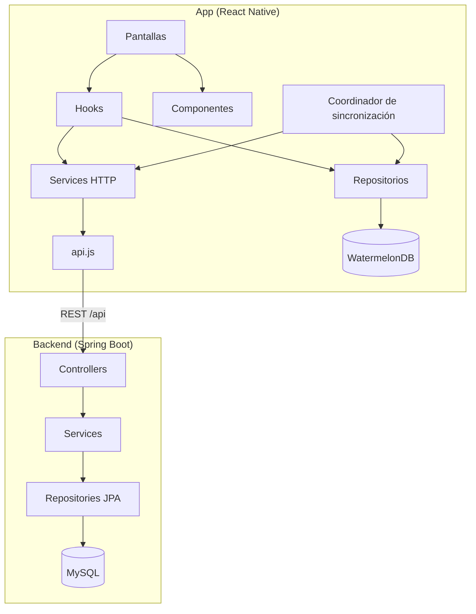

# Hallado

Aplicación móvil para publicar y encontrar **objetos y mascotas perdidos**. Quien pierde algo lo publica desde el celular; quien encuentra algo en la calle lo publica para devolverlo. La app conecta ambas partes, verifica los reclamos y acompaña la devolución hasta el punto de encuentro.

Trabajo Práctico Obligatorio de **Desarrollo de Aplicaciones I** (UADE) — Grupo 2.

## Funcionalidades

| # | Punto del TPO | Resumen |
|---|---|---|
| 1 | Autenticación | Registro email → código OTP → contraseña, ingreso, recupero de contraseña y desbloqueo biométrico |
| 2 | Perfil y reputación | Datos personales, visibilidad del teléfono, reputación e insignias, perfil público |
| 3 | Buscador | Buscador guiado, búsqueda del tipo opuesto, búsquedas recientes, resultados paginados con filtros y orden |
| 4 | Detalle | Galería, datos del suceso, publicador y acciones según quién mira |
| 5 | Publicar | Carga guiada con fotos, ubicación, fecha y hora, borrador, Mis publicaciones, vencimiento a 30 días y renovación |
| 6 | Sin conexión | Publicaciones y fotos consultadas, últimos resultados y publicaciones pendientes de envío |
| 7 | Reclamos | "Es mío" / "Lo encontré" con evidencia, máximo 3 intentos, vencimiento a 48 horas |
| 8 | Encuentro | Propuesta y aceptación del punto de encuentro y "Cómo llegar" |
| 9 | Alertas y seguidas | Búsquedas guardadas como alerta y publicaciones seguidas con indicador de novedades |
| 10 | Historial | Devolví / Recuperé, filtros y valoraciones |

## Stack

| Capa | Tecnología |
|---|---|
| App | React Native 0.88 · Expo SDK 58 (**development build**, no Expo Go) · JavaScript |
| Navegación | React Navigation 7 (native stack + bottom tabs) |
| Datos locales | WatermelonDB 0.28 (SQLite) · SecureStore (token) · AsyncStorage (preferencias) · sistema de archivos (fotos) |
| Backend | Java 17 · Spring Boot 3.3 · Spring Security + JWT · Spring Data JPA |
| Base de datos | MySQL 8 (H2 en los tests) |

## Arquitectura



**App**
- **Pantallas** (`src/screens`): renderizan y navegan. No llaman a la API ni a la base local directamente; la excepción son los flujos lineales de autenticación, que usan `authService` sin hook intermedio.
- **Hooks** (`src/hooks`): estado de cada caso de uso, carga de datos y acciones. Las pantallas los consumen.
- **Services** (`src/services`): una función por endpoint. `api.js` centraliza `fetch`, el token de sesión, el caché offline y la expiración de sesión.
- **Repositorios y storage** (`src/repositories`, `src/storage`): acceso a WatermelonDB.
- **Sincronización** (`src/sync`): un único coordinador envía las publicaciones pendientes al reconectar, volver al primer plano o iniciar sesión.
- **Contexto** (`src/context/AuthContext.js` + `useAuth`): sesión del usuario sin pasar props entre niveles.

**Backend**
- **Controllers**: reciben la petición y delegan; devuelven DTOs, nunca entidades.
- **Services**: reglas de negocio (vencimientos, reclamos, reputación, seguimiento).
- **Repositories**: Spring Data JPA; las búsquedas usan `Specification`.
- **Tareas programadas**: vencimiento de reclamos (48 h) y de publicaciones (30 días).
- **`GlobalExceptionHandler`**: traduce las excepciones de dominio a códigos HTTP con un mensaje claro.

### Patrones utilizados

| Patrón | Dónde |
|---|---|
| Repository | `src/repositories` en la app, Spring Data en el backend |
| Custom hooks / Container–Presentational | Hooks con la lógica, pantallas y componentes con la vista |
| Context / Provider | `AuthContext` |
| Observer | Observables de WatermelonDB en Mis publicaciones |
| Facade | `api.js` sobre `fetch` y XHR |
| Inyección de dependencias | `syncEngine.js` (testeable sin runtime nativo) y constructores de Spring |
| DTO | Respuestas del backend (`dto/`) |
| Specification | Filtros de búsqueda y alertas (`PublicationSpecification`) |
| Idempotencia | Clave `X-Idempotency-Key` en la creación de publicaciones |

### Persistencia local

| Dónde | Qué guarda |
|---|---|
| SecureStore | Token JWT |
| AsyncStorage | Preferencia de desbloqueo biométrico y datos de versiones anteriores |
| WatermelonDB `publications` | Publicaciones consultadas y propias, para verlas sin conexión |
| WatermelonDB `pending_operations` | Cola de publicaciones pendientes de envío, con su clave de idempotencia |
| WatermelonDB `cache_entries` | Borrador, búsquedas recientes, últimos resultados y caché de respuestas, por usuario |
| Sistema de archivos | Fotos descargadas y fotos pendientes de subir, en una carpeta por cuenta |

Todo lo local está separado por cuenta. Los datos de versiones anteriores (guardados en AsyncStorage) se ofrecen para importar al iniciar sesión y solo se importan si el usuario lo confirma, sin borrar el original; si una foto vieja ya no existe, la publicación pendiente queda marcada para corregirla.

## Estructura

```text
App.js · index.js           Punto de entrada y providers
src/
  screens/                  Pantallas: auth, tabs, publication, profile
  components/               Componentes de vista, agrupados por funcionalidad:
                            alerts, auth, claim, guidedSearch, history, home,
                            profile, publication, publish (+ comunes en la raíz)
  hooks/                    Un hook por caso de uso (useClaims, useAlerts,
                            usePublishForm, useMyPublications, useEditProfile…)
  services/                 api.js y un service por dominio
  repositories/  storage/   Acceso a la base local
  database/                 Schema, migraciones y modelos de WatermelonDB
  sync/                     Coordinador y motor de sincronización
  context/                  Sesión (AuthContext)
  navigation/               Navegadores y enlaces profundos (hallado://)
  constants/  utils/        Constantes, estilos compartidos, fechas y validaciones
backend/
  src/main/java/com/hallado/backend/
    controller/ service/ repository/ model/ dto/ exception/ config/
scripts/                    postinstall y preparación de la build Android
docs/                       Instalación, development build y verificación
tests/                      Tests de la app (node --test)
```

## Instalación y ejecución

La guía completa, con requisitos y solución de problemas, está en **[docs/INSTALACION.md](docs/INSTALACION.md)**. La compilación local o con EAS está en [docs/DEVELOPMENT.md](docs/DEVELOPMENT.md).

| Cuándo | Comando |
|---|---|
| Primera vez y cuando cambian dependencias nativas | `instalar.bat` |
| Día a día: backend + Metro + app en el emulador | `iniciar.bat` |

| Servicio | Puerto |
|---|---|
| Backend (`/api`) | 8081 |
| Metro | 8082 |

Variables:

| Variable | Dónde | Valor por defecto |
|---|---|---|
| `EXPO_PUBLIC_API_URL` | `.env.local` de la app | `http://10.0.2.2:8081/api` (emulador). En un teléfono físico, la IP LAN de la computadora |
| `MAIL_USERNAME`, `MAIL_PASSWORD` | Entorno del backend | Definidas en `start-backend.bat` |

## API

| Recurso | Endpoints |
|---|---|
| Autenticación | `POST /auth/login` · `/auth/register/{start,verify,complete}` · `/auth/otp/{send,verify,resend}` · `/auth/password/{verify,reset}` |
| Publicaciones | `GET /publications/search` · `GET /publications/{id}` · `POST /publications` · `PUT /publications/{id}` · `GET /publications/{id}/edit` · `DELETE /publications/{id}` · `POST /publications/{id}/renew` · `GET /publications/mine` |
| Seguimiento | `POST/DELETE/GET /publications/{id}/follow` · `GET /publications/followed` · `GET /publications/followed/updates-count` · `POST /publications/{id}/seen` |
| Reclamos | `POST /claims/{publicationId}` · `PATCH /claims/{id}/respond` · `GET /claims/my-sent` · `GET /claims/my-received` |
| Encuentro | `PUT /claims/{id}/meeting-point` · `POST /claims/{id}/meeting-point/accept` |
| Historial | `GET /claims/resolved-history` · `POST /claims/{id}/rating` |
| Alertas | `GET/POST /alerts` · `GET /alerts/{id}/publications` · `POST /alerts/{id}/seen` · `PUT /alerts/{id}/active` · `DELETE /alerts/{id}` |
| Usuario | `GET/PUT /usuarios/me` · `POST /usuarios/me/imagen` · `GET /usuarios/{id}/publico` |
| Estado | `GET /health` |

## Tests

```powershell
npm test                      # app
cd backend; .\mvnw.cmd test   # backend
```

| | Qué cubren |
|---|---|
| App | Transporte HTTP e idempotencia, sesión y token, base local y migración de datos anteriores, cola de sincronización, navegación y enlaces, fechas (zona horaria de Argentina) y validación de publicaciones |
| Backend | Registro y recupero, fecha del suceso, vencimiento y renovación de publicaciones, vencimiento de reclamos, seguimiento, idempotencia, alta con y sin fotos y manejo global de errores |

Los tests no reemplazan el recorrido en Android descrito en [docs/VERIFICATION.md](docs/VERIFICATION.md).

## Decisiones técnicas

- **Development build en lugar de Expo Go.** WatermelonDB necesita código nativo que Expo Go no incluye.
- **WatermelonDB para lo offline.** Consultas reactivas sobre SQLite y escrituras transaccionales: una publicación y su operación pendiente se guardan juntas.
- **Cola propia sobre la API REST** en lugar del protocolo de sincronización de WatermelonDB: solo se encolan altas de publicaciones; el resto de las acciones requiere conexión, como pide la consigna.
- **Idempotencia en el alta.** Cada pendiente viaja con la misma clave en todos sus reintentos; el backend devuelve la misma publicación aunque se haya perdido la respuesta.
- **Fechas en hora local.** El backend usa `LocalDateTime`; la app envía y muestra la hora local mediante `src/utils/date.js`.
- **Backend en Java.** Reutiliza la API REST del TP anterior (Ronda) sobre la misma base MySQL.
